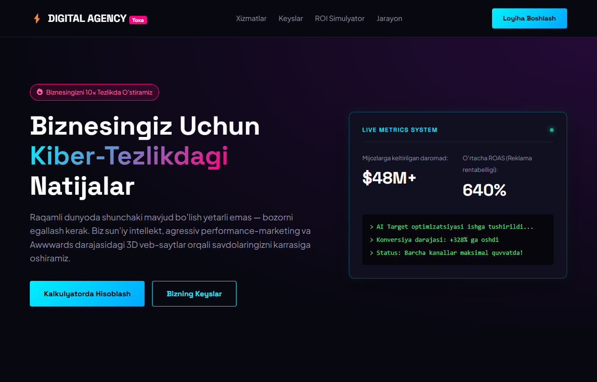

# Digital Agency (Toxa) — Kiber-Marketing, Web3 & Yuqori Konversiyali Raqamli Agentlik

Digital Agency — zamonaviy korxona va startaplar uchun sun'iy intellektga asoslangan performance marketing, 3D interaktiv veb-saytlar va avtomatlashtirilgan CRM sotuv voronkalarini yaratuvchi to'liq tsiklli kiber-agentlik interfeysi (UI).

---

## 📸 Veb-Sahifa Ko'rinishi (Skrinshot)



---

## 🌟 Asosiy Imkoniyatlar va Funksiyalar

1. **Interaktiv ROI & Reklama Byudjeti Simulyatori**:
   - Oylik byudjet ($1,000 dan $50,000 gacha) va soha yo'nalishi (E-Com, B2B, Ko'chmas mulk, EdTech) bo'yicha kutilayotgan daromad va sof foydani real vaqtda hisoblash.

2. **Jonli Live HUD Metrikalar Paneli**:
   - Kompaniya statistikasi, ROAS ko'rsatkichi va kiber-terminal buyruqlari.

3. **Futuristik Kiberpank Dizayni**:
   - Neon sian va binafsha porlash, *Space Grotesk* va *Plus Jakarta Sans* shriflari.

---

## 🛠 Texnologiyalar Steki

- **HTML5**: To'liq semantik ierarxiya va qulay navigatsiya.
- **Vanilla CSS3**: Kiberpank ranglar gammasi, Glassmorphism va silliq mikro-animatsiyalar.
- **JavaScript (ES6+)**: Oylik marketing hisobi algoritmi va interaktiv simulyator.

---

## 🚀 O'rnatish va Ishga Tushirish

1. Omborni klonlang:
   ```bash
   git clone https://github.com/qodirovtoirbektts-jpg/toxa-digital-agency.git
   ```
2. Papkaga kiring:
   ```bash
   cd toxa-digital-agency
   ```
3. `index.html` faylini brauzeringizda oching.

---

## 🔗 Jonli Havolalar

- **GitHub Repozitoriyasi**: [https://github.com/qodirovtoirbektts-jpg/toxa-digital-agency](https://github.com/qodirovtoirbektts-jpg/toxa-digital-agency)
- **Jonli Veb-Sahifa (GitHub Pages)**: [https://qodirovtoirbektts-jpg.github.io/toxa-digital-agency/](https://qodirovtoirbektts-jpg.github.io/toxa-digital-agency/)

---

## 👤 Muallif

- **Muallif**: Toxa ([qodirovtoirbektts-jpg](https://github.com/qodirovtoirbektts-jpg))
